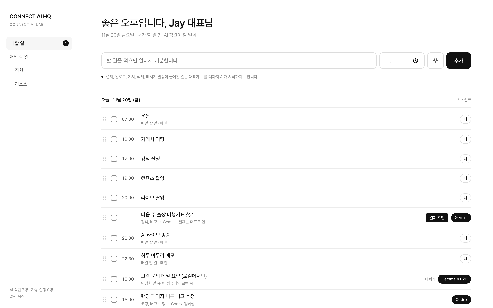

# CONNECT AI HQ v2

**Optimize your life and AI work together in the age of AI.**

CONNECT AI HQ v2 is a zero-dependency, local-first personal AI company OS. It unifies **your personal condition (life & health)**, **your AI staff (workforce & characters)**, and **your AI offices (computers, browsers, smartphones)** inside one minimalist White & Black gallery dashboard. Humans stay healthy and make decisions; AI employees execute, hand off, and report back safely.

Free · Source available · Zero npm dependencies · Your data stays on your computer · [한국어](README.md) · [Changelog](CHANGELOG.md)



> Note: The UI is currently in Korean, with English support in safety gates and documentation.

## What's New in v2 — Life · AI Staff · AI Offices

1. **Life & Founder Condition Optimization**
   - Local-only health ingestion (`POST /api/health/ingest` with `X-AIHQ-Health-Token`) for Apple Health (iOS Shortcuts) & Android Health Connect, plus 5-second manual logging.
   - 3 ring gauges (steps, sleep, heart rate/exercise), 7-day trend SVG chart, and daily delegation suggestions when you're tired. Health data is strictly excluded from exported blueprints, daily reports, and AI prompts.
2. **AI Staff Optimization & Character Studio**
   - **One-command 9-tool setup (`connect --yes` / `disconnect --yes`)**: Auto-detects **Claude Code, Codex, Antigravity (`agy`), Gemini CLI, OpenCode, Cursor, Windsurf, Claude Desktop, and LM Studio**, safely merges `aihq` MCP entries with automatic `.bak` backups, preserves all existing MCP servers, and installs shared agent skills (`~/.agents/skills/aihq-employee`).
   - **Native headless runners**: `claude -p`, `codex exec`, `agy -p`, `gemini -p`, `opencode run`, plus local `Ollama` / `LM Studio` — never using permission-skipping flags.
   - **CONNECT AI LAB Character Studio**: Vibrant full-color **Korean Traditional K-Suho Crew (8 characters)** (`Haetae`, `Dokkaebi`, `Kkachi`, `Minhwa Horangi`, `Cheongnyong`, `Dalto`, `Jangseung`, `Bonghwang`) + **Modern Lab Crew (8)**, 4 styles (`Studio 3D`, `Coding Motion`, `Pixel Pet`, `Color Minimal`), **custom character nickname & image upload (click / drag-and-drop / `Cmd+V` paste)**, and reusable personal avatar library (up to 16).
   - **5-hour local token usage gauges** (bounded-tail read of local Claude & Codex JSONL logs) + automatic 429 cooldown & fallback AI handoff.
   - **Instant auto-start on task add** for `auto`-mode AI employees (safely halted on payment/publish/delete gates) + macOS desktop notifications on completion and approval requests.
3. **AI Office & Runtime Optimization**
   - Minimalist White & Black **Company Live Dashboard** (`#dashboard`): interactive 3-column SVG topology graph, workload bars, 24h timeline, live RAM trend chart (`85%` safety cap).
   - **Smartphone Pocket Live View** (`#pocket`): compact mobile command center with character cards, token bars, 1-tap approvals, and quick 1-line delegation.
   - **Runtime resilience**: 180s hang-watchdog with automatic backup failover, macOS `caffeinate` power guard while jobs run, RAM 85% backpressure queue & secondary-machine rerouting.
   - **Access channels**: Computer Use toggle, 7 browsers (`Ego Lite`, `Aside`, `Chrome`, `Dia`, `Comet`, `Arc`, `Safari` + custom), iPhone Mirroring / Android `adb` guardrails, and shareable workflow **Blueprints** (privacy-scrubbed).

## Quick Start

```bash
# 1. Launch CONNECT AI HQ locally (opens http://127.0.0.1:8790)
npx github:wonseokjung/connect-ai-autonomous-company

# 2. Preview or connect all installed vibe-coding tools in one command (.bak backups)
npx github:wonseokjung/connect-ai-autonomous-company connect --dry-run
npx github:wonseokjung/connect-ai-autonomous-company connect --yes

# 3. Cleanly disconnect aihq only (keeps all your other MCP servers intact)
npx github:wonseokjung/connect-ai-autonomous-company disconnect --yes
```

Try with an example company in an isolated folder:

```bash
AIHQ_SEED=example AIHQ_DATA_DIR=./example-data npx github:wonseokjung/connect-ai-autonomous-company
```

## Safety & Security

- Binds strictly to `127.0.0.1` (optional Wi-Fi Pocket View requires an explicit toggle and a single-use 6-digit pairing code).
- Hard safety gates halt **payments, uploads, publishing, deletions, and outgoing messages** until the human owner approves in the UI; AI agents (CLI & MCP) have no approval or roster-editing tools.
- Per-account automation policies (`deny / approval / allow`) across creator & commerce channels; passwords, 2FA, and payments remain strictly human-only.
- Malformed third-party MCP JSON configs are never overwritten by `connect`; `.bak` backups are created before every edit.

## Tests

```bash
npm test
```

Runs **56 automated tests** covering end-to-end first-time user simulation (9-tool `connect`/`disconnect`, empty onboarding, `agy`/`opencode` instant auto-start, gate halt), 47 safety gates, assignment, RAM 85% & token failover, hang-watchdog & caffeinate, 5-hour token scanning, health privacy isolation, custom avatar XSS protection, and blueprint scrubbing.

## License

Free · Source available (fair-code). Individuals and organizations with fewer than 5 people may use and modify it internally at no cost. Organizations with 5 or more people, resale, hosted services, and paid courses built with it require permission from CONNECT AI LAB. See [LICENSE.md](LICENSE.md) (Korean: [LICENSE.ko.md](LICENSE.ko.md)).

CONNECT AI LAB · Optimize your life and AI work in the age of AI
