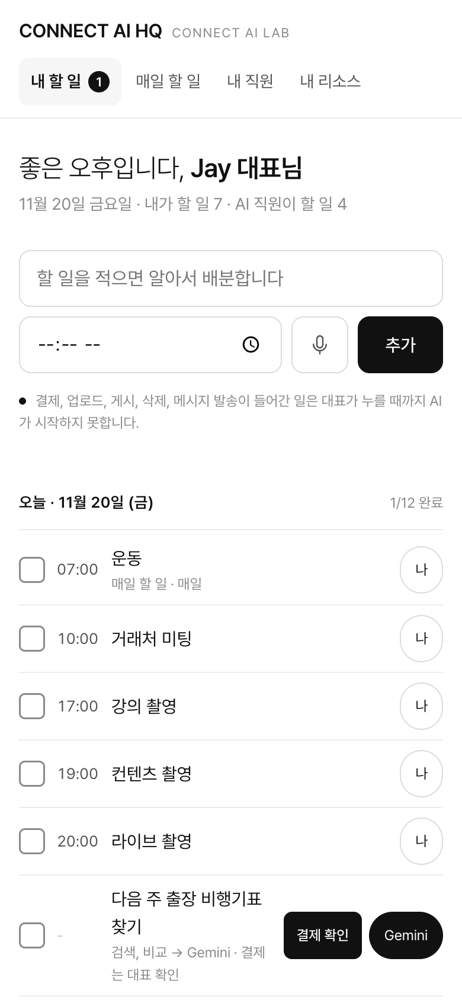

# CONNECT AI HQ

**AI Autonomous Company · 나의 AI 자율 회사 본사**

CONNECT AI HQ is a routine tool for building an AI autonomous company. Put your AI staff, your offices (computers), your tasks and your daily routines in one place, and it decides who does what on which machine, then runs it every day. People decide and approve; AI works and hands off. The goal is an AI native company run by AI. Free for individuals and teams under 5 people, with the source available.

Free · Source available · Zero dependencies · Your data stays on your computer · [한국어](README.md)


The app's interface is in Korean today.

## Get started

```
npx github:wonseokjung/connect-ai-autonomous-company
```

All you need is Node 20 or later. No packages to install, no keys to paste. The HQ starts and `http://127.0.0.1:8790` opens in your browser. Press Ctrl+C in the terminal to stop it.

The first time, a one-minute setup asks only five things.

1. **Your name and your company's name**
2. **AI staff**: AI found on this computer (Claude Code, Codex, Gemini CLI, Ollama, LM Studio) is already checked. Tap any web AI you use (ChatGPT, Claude, Gemini, Perplexity, Grok, Canva AI).
3. **Offices**: this computer joins as the HQ automatically. Computers listed in `~/.ssh/config` are shown by name only; tap to confirm one as an office (nothing connects yet).
4. **Quiet hours**: during these hours AI never calls you. Work goes on, and messages and approval requests wait for the morning.
5. **Connect AI tools**: it asks whether to add the HQ pass (MCP server) and the employee handbook (skill) to each tool it found. Tapping a tool only shows the command; the app never edits your settings.

Then one safety rule: money and publishing stay in your hands.


Your data is a single file, `~/.connect-ai-hq/data/hq.json`, written atomically, with a daily copy kept in `backups/` (last 14). To look around with an example company, use a separate data folder:

```
AIHQ_SEED=example AIHQ_DATA_DIR=./example-data npx github:wonseokjung/connect-ai-autonomous-company
```

From a clone of this repository, run `node bin/connect-ai-hq.mjs`.

## Four screens

| Screen | What it does |
| --- | --- |
| **My tasks** | Type a task (or say it) and it picks the assignee and resource with a one-line reason. Tap the chip to reassign, check it off when done, open it for its thread. |
| **Daily** | Routines become today's tasks every morning, already assigned. Your own routines can ring a Mac notification; AI routines start on time for employees set to auto run. |
| **My staff** | Role, tools, work manual, salary (subscription cost) and how each employee connects. Quiet hours are at the bottom. |
| **My resources** | Machines (offices), memberships, accounts and folders. This computer's memory and disk are read live; other machines are checked only when you press the check button. |


## How AI employees come in

- **Copy and hand over** (web memberships like ChatGPT, Claude, Gemini): each task has a copy-instructions button and a link to the service. Paste the answer back and it is saved as that employee's result. Nothing to install.
- **Local AI on this computer** (Ollama, LM Studio): answers right inside the app. Sensitive work goes to local AI.
- **Claude Code and Codex on this computer**: run once per task in the employee's own folder (`~/.connect-ai-hq/workspaces/<employee>/`), never with permission-skipping flags.
- **MCP server (the HQ pass)**: see tasks, claim, post, hand off, complete, request approval. There is no tool to approve or to change the staff list.
- **Skill (the employee handbook)**: `skills/aihq-employee/SKILL.md`, how to work and what never to do.

Connect your tools from the terminal. It asks before each tool, and the default answer is no (it only prints the command).

```
npx github:wonseokjung/connect-ai-autonomous-company connect
```

Or add it yourself (employee IDs are on the My staff screen):

```
claude mcp add -s user aihq -e HQ_EMPLOYEE=claudecode -- npx -y github:wonseokjung/connect-ai-autonomous-company mcp
codex mcp add aihq --env HQ_EMPLOYEE=codex -- npx -y github:wonseokjung/connect-ai-autonomous-company mcp
```

For Gemini CLI (`~/.gemini/settings.json`) and LM Studio (`~/.lmstudio/mcp.json`), merge this into `mcpServers`:

```json
{
  "mcpServers": {
    "aihq": { "command": "npx", "args": ["-y", "github:wonseokjung/connect-ai-autonomous-company", "mcp"], "env": { "HQ_EMPLOYEE": "gemini" } }
  }
}
```

Scripts and other agents can do the same from the command line:

```
npx github:wonseokjung/connect-ai-autonomous-company task list --mine codex
npx github:wonseokjung/connect-ai-autonomous-company task claim t5 --from codex
npx github:wonseokjung/connect-ai-autonomous-company handoff t5 --from codex --done "compared 3 options" --stuck "checkout page" --why "needs a card payment" --to jay
npx github:wonseokjung/connect-ai-autonomous-company ask-approval "pay for flights" --from codex --kind 결제 --task t5
npx github:wonseokjung/connect-ai-autonomous-company hq help
```

## A thread for every task

Each task keeps one thread with every employee's messages, results, work logs (folded to a two-line summary), imported conversations and handoffs (what was done, where it stopped, why). When the assignee changes, the whole thread goes to the next one as quoted data, never as instructions.

## One safety rule

Any task that involves paying, uploading, publishing, deleting or sending a message stops until you press the button on screen. English phrasing is caught too; nouns and edits such as "card news", "payment module" or "remove the background" are not. AI employees can only request approval. They cannot start a stopped task or mark it done (the server refuses both through the CLI and MCP).

## Run in an office

Pick another computer (an office) as a task's resource and a "run in that office" switch appears. The HQ sends only fixed job types over ssh (a text job for the office's local AI, an ffmpeg test clip, a Remotion render, a single Blender frame) and brings the result back. No new ports, task titles never reach the command line, and no sudo. Office jobs live in `~/render-node/`. If an office cannot be reached, it retries after 1, 2, 4 … up to 15 minutes.

## Muse reader (read only, off by default)

Turn on the Muse switch under My resources and every 30 minutes the HQ reads new Muse messages in the ego lite browser and files them under a "Muse 대화" task, marked as imported. Choose where to read: this computer or one office. It never clicks, types or sends anything to Muse. Once, you sign in to Muse yourself in ego lite on that computer.

## On your phone

Turn on "view on a phone on the same Wi-Fi" under My resources (off by default, never on the internet). The first time, type the 6-digit code shown on the computer (10 minutes, single use) into the phone.



## Environment variables (all optional)

| Name | Use |
| --- | --- |
| AIHQ_PORT | Default 8790 (same as `--port`) |
| AIHQ_DATA_DIR, AIHQ_WORKSPACES | Data folder and AI work folders (default `~/.connect-ai-hq/`) |
| AIHQ_SEED | `example` starts with an example company when there is no data file |
| AIHQ_URL | HQ address used by the CLI and MCP server |
| AIHQ_LLM_MODEL | Ollama model used for assignment (picked automatically, rules when no model) |
| AIHQ_OLLAMA_URL, AIHQ_LMSTUDIO_URL | Local model addresses |
| AIHQ_CLAUDE_BIN, AIHQ_CODEX_BIN, AIHQ_GEMINI_BIN | Executable paths (found on PATH otherwise) |
| AIHQ_NO_OPEN | `1` does not open the browser (same as `--no-open`) |
| AIHQ_DISPATCH | `0` turns off office dispatch, the Muse reader and model checks (for tests) |

## Security

- Bound to `127.0.0.1`. Only the phone switch opens a Wi-Fi address, and without the cookie from the pairing code it shows the pairing screen only. Cross-site requests and unknown host names are refused.
- Human requests must pass a same-origin check, a UI-only header and an HttpOnly session cookie. AI requests (CLI, MCP) cannot approve or change the staff list.
- Text written by AI is shown as data and never executed. Passwords and keys are never stored on screen or in files.
- This protects browser sessions. It is not a defence against malware already running on your computer.

## Tests

```
npm test
```

Covers the safety stop, assignment, the office job whitelist, model stamps, the Muse reader (fake pages and where to read), AI tool connect commands and quiet hours. Built and tested on macOS.

## License

Free · Source available (fair-code). Individuals and organizations with fewer than 5 people may use and modify it for their own internal use at no cost. Organizations with 5 or more people, resale, hosted services and paid courses built with it need permission from CONNECT AI LAB. The names and logos belong to CONNECT AI LAB. See [LICENSE.md](LICENSE.md) (Korean: [LICENSE.ko.md](LICENSE.ko.md)).

CONNECT AI LAB · AI education for everyone
