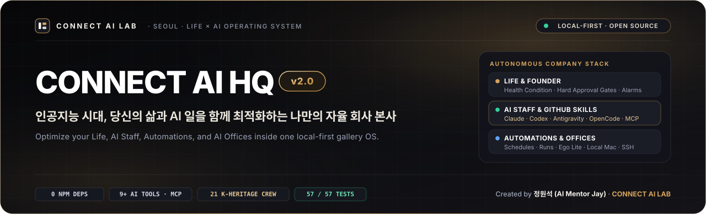
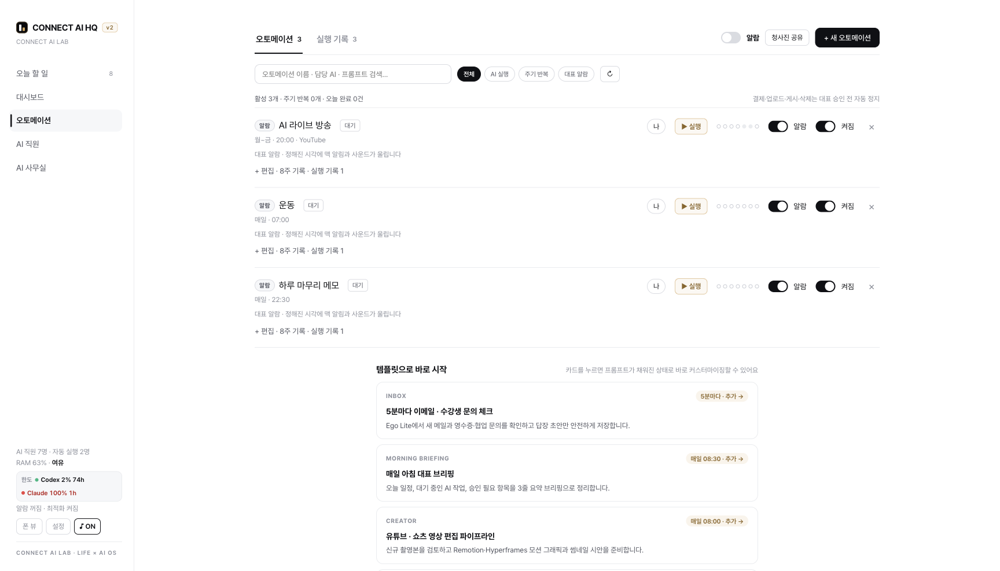
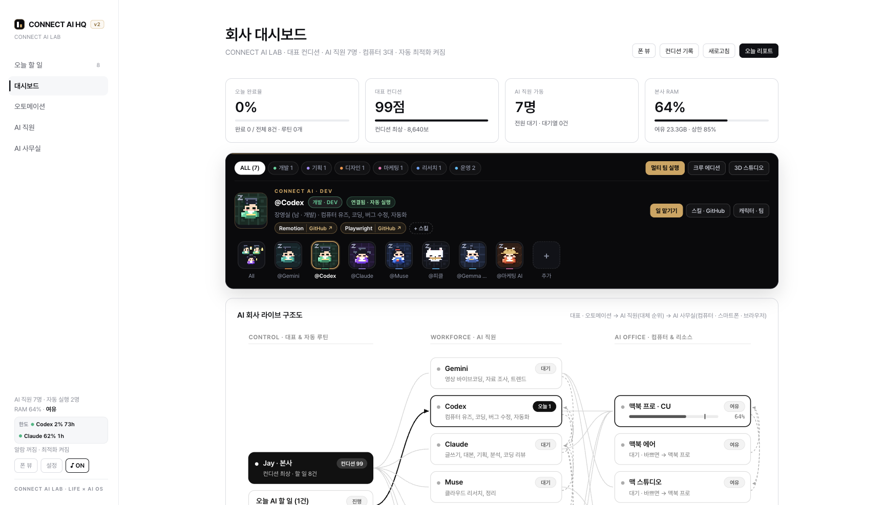
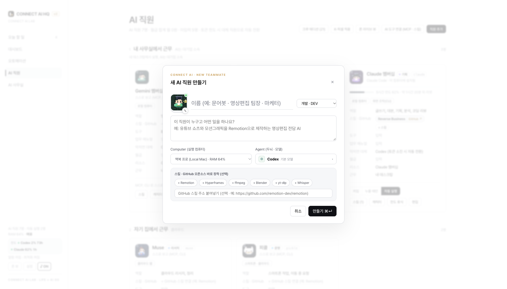
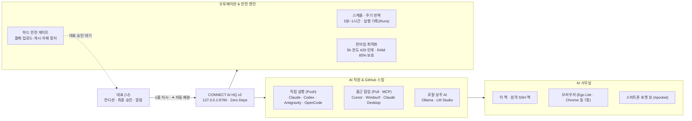
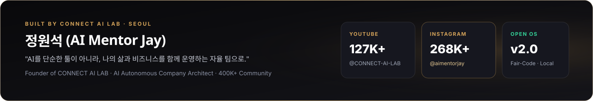

<div align="center">

<a href="https://github.com/wonseokjung/connect-ai-autonomous-company">
  
</a>

<br />
<br />

<p>
  <a href="CHANGELOG.md"></a>
  =20" />
  
  
  <a href="https://www.youtube.com/@CONNECT-AI-LAB"></a>
  <a href="https://www.instagram.com/aimentorjay"></a>
</p>

<p>
  <strong><a href="README.md">한국어</a></strong> &nbsp;·&nbsp;
  <a href="README.en.md">English</a> &nbsp;·&nbsp;
  <a href="#-1분-시작하기">1분 시작하기</a> &nbsp;·&nbsp;
  <a href="#-제품-화면-미리보기">화면 미리보기</a> &nbsp;·&nbsp;
  <a href="#-핵심-기능-하이라이트">핵심 기능</a> &nbsp;·&nbsp;
  <a href="#-connect-ai-lab--16-bit-k-heritage-픽셀-크루-21종">16-bit 픽셀 크루</a> &nbsp;·&nbsp;
  <a href="#-안전-규칙--보안">안전 규칙</a> &nbsp;·&nbsp;
  <a href="#-connect-ai-lab--ai-mentor-jay">브랜드</a> &nbsp;·&nbsp;
  <a href="CHANGELOG.md">Changelog</a>
</p>

<p>
  <strong>CONNECT AI HQ v2</strong>는 단순히 할 일을 적는 앱이 아닙니다.<br />
  <b>나의 삶(컨디션·건강)</b> · <b>나의 AI 직원(팀·스킬)</b> · <b>오토메이션(스케줄·실행 기록)</b> · <b>AI 사무실(컴퓨터·브라우저·스마트폰)</b>을<br />
  단 하나의 로컬 갤러리 OS에 연결하는 <b>CONNECT AI LAB</b>의 오픈소스 1인 AI 자율 회사 본사입니다.
</p>

</div>

---

## ⚡ 1분 시작하기

외부 npm 의존성 **0개**, API 키 입력 **0개**. Node 20 이상이면 터미널 한 줄로 바로 열립니다.

```bash
npx github:wonseokjung/connect-ai-autonomous-company
```

실행 즉시 브라우저에서 `http://127.0.0.1:8790`이 열립니다. 종료는 `Ctrl+C`.

### 내 바이브코딩 툴 9종 원클릭 연결 (`MCP + 직원 수첩 스킬`)

```bash
# 1) 변경될 파일만 미리보기 (아무 파일도 수정하지 않음)
npx github:wonseokjung/connect-ai-autonomous-company connect --dry-run

# 2) 설치된 모든 바이브코딩 툴에 MCP + 공용 스킬 안전 병합 (.bak 자동 백업)
npx github:wonseokjung/connect-ai-autonomous-company connect --yes

# 3) aihq만 깔끔하게 연결 해제 (기존 다른 MCP 서버 설정 100% 보존)
npx github:wonseokjung/connect-ai-autonomous-company disconnect --yes
```

> **자동 감지 · 연결 지원 9종**: `Claude Code` · `Codex` · `Antigravity (agy)` · `Gemini CLI` · `OpenCode` · `Cursor` · `Windsurf` · `Claude Desktop` · `LM Studio` + 공용 에이전트 스킬(`~/.agents/skills/aihq-employee`)

<details>
<summary><b>예시 회사 데이터로 10초 만에 둘러보기 (내 데이터와 완전 격리)</b></summary>

```bash
AIHQ_SEED=example AIHQ_DATA_DIR=./example-data npx github:wonseokjung/connect-ai-autonomous-company
```

저장소를 클론한 뒤 직접 실행할 때는 `node bin/connect-ai-hq.mjs`를 사용합니다.

</details>

---

## 🖼 제품 화면 미리보기

### 1. 오늘 할 일 × Matte Black `LIVE CREW` 히어로 (`#home`)
Enter 한 번으로 **✦ 자동 배분**이 실제 연결된 AI 직원과 최적 컴퓨터를 매칭하고, 직원별 **GitHub 오픈소스 스킬**(`Remotion`, `Playwright`, `Reverse Business` 등)까지 자동 주입합니다.


### 2. 2-탭 오토메이션 & 실행 기록 · 라이브 대시보드

<table>
  <tr>
    <td width="50%" valign="top">
      
      <br />
      <sub><b>오토메이션 · 실행 기록 (<code>#automations</code>)</b> — 2-탭 분리, 실시간 검색·필터, <code>▶ 실행</code> 즉시 가동, 1인 AI 대표 템플릿 5종, <code>+ 새 오토메이션</code> 모달 및 좌측 실시간 5시간 토큰 한도 바</sub>
    </td>
    <td width="50%" valign="top">
      
      <br />
      <sub><b>라이브 대시보드 (<code>#dashboard</code>)</b> — 인터랙티브 3단 SVG <b>AI 회사 라이브 구조도</b>, 대표 컨디션(헬스) 게이지, 본사 RAM 85% 보호 상한 및 실시간 추이</sub>
    </td>
  </tr>
  <tr>
    <td width="50%" valign="top">
      
      <br />
      <sub><b>AI 직원 &amp; GitHub 스킬 (<code>#staff</code>)</b> — 3종 AI 직원(내 사무실 · 클라우드 · 로컬) 관리, 직원별 GitHub 오픈소스 스킬 부착, 5시간 한도 게이지 &amp; 대체 AI 자동 인계</sub>
    </td>
    <td width="50%" valign="top">
      
      <br />
      <sub><b>새 AI 직원 생성기</b> — 21종 K-Heritage 크루 아바타, 팀·역할, 실행 컴퓨터, Provider/Model/Thinking 강도(<code>Default·Low·Med·High</code>) &amp; 1클릭 오픈소스 스킬 장착</sub>
    </td>
  </tr>
</table>

---

## 🏛 시스템 구조 — 삶 · AI 직원 · 오토메이션 · AI 사무실



---

## ✨ 핵심 기능 하이라이트

| 영역 | v2.0 핵심 기능 |
| --- | --- |
| **🎯 메인 AI · `✦ 자동 배분`** | 온보딩·홈에서 기본 AI와 메인 컴퓨터를 카드 UI로 지정. Enter 한 번으로 **실제 실행 연결된 AI**에만 자동 위임(미연결 AI 오배정 차단), 대표 알람(`10초 뒤`, `오전 9시 30분`)은 맥 알림·사운드로 즉시 예약 |
| **⏱ 2-탭 오토메이션 & 실행 기록** | **`오토메이션`** / **`실행 기록(Runs)`** 2-탭 구성, 실시간 검색·필터, **`▶ 실행`** 1클릭 즉시 실행, 크리에이터·1인 대표 실전 템플릿 5종(`INBOX`, `MORNING BRIEFING`, `CREATOR`, `GROWTH`, `SYSTEM`), 청사진(Blueprint) 공유 |
| **🧩 직원별 GitHub 오픈소스 스킬** | `Remotion`, `Hyperframes`, `Blender`, `Playwright`, `Firecrawl`, `Reverse Business` 등 GitHub 주소/카탈로그를 직원별로 연결 → 자동 라우팅 · 프롬프트 자동 주입 · MCP 노출 · 청사진 내보내기 |
| **🤖 새 AI 직원 생성기** | 아바타, 팀, 역할 지시서, 실행 컴퓨터, **Provider · Model · Thinking 강도(`Default · Low · Med · High`)**, 1클릭 스킬 장착까지 한 모달에서 즉시 채용 |
| **📊 실시간 5시간 토큰 한도 & 자동 인계** | 좌측 사이드바 하단 실시간 한도 바(`Codex 2% · Claude 100%`), 로컬 JSONL 안전 스캔, 429 한도 도달 시 쿨다운 + 대체 AI(`fallbackTo`) 자동 바통 터치 |
| **💚 대표 컨디션 · 헬스 최적화** | Apple Health(iOS 단축어) · Android Health Connect · 5초 기록 지원. 피곤한 날엔 AI 위임 제안. 건강 데이터는 로컬 `hq.json`에만 격리(청사진·리포트·AI 프롬프트 절대 미포함) |
| **🛡 런타임 안정화 & AI 사무실** | RAM **85%** 상한 보호 · 대체 컴퓨터 우회 · 대기열 보호, 3분 먹통 감시(`hang-watchdog`), 작업 중 맥 잠자기 방지(`caffeinate`), 7종 브라우저(`Ego Lite` 등) · 스마트폰 포켓 뷰(`#pocket`) |

---

## 🎨 CONNECT AI LAB · 16-bit K-Heritage 픽셀 크루 (21종)

한국 전통 인물 20인과 공식 마스코트 사모예드 **솜이**로 구성된 **20×20 16-bit K-Heritage 픽셀 에디션 (21종)** 이 기본 탑재됩니다. 일할 땐 초록불 + 작업 애니메이션, 쉴 땐 `Z` 수면 모션으로 살아 움직이며, 직원별 호칭(이름) 지정과 `⌘V` 이미지/GIF 직접 업로드도 지원합니다.

<div align="center">
<table>
  <tr>
    <td align="center" width="12.5%"><br /><sub><b>솜이</b><br />공식 마스코트</sub></td>
    <td align="center" width="12.5%"><br /><sub><b>세종대왕</b><br />본사 총괄</sub></td>
    <td align="center" width="12.5%"><br /><sub><b>장영실</b><br />개발·자동화</sub></td>
    <td align="center" width="12.5%"><br /><sub><b>집현전 선비</b><br />기획·글쓰기</sub></td>
    <td align="center" width="12.5%"><br /><sub><b>신사임당</b><br />브랜드·디자인</sub></td>
    <td align="center" width="12.5%"><br /><sub><b>보부상</b><br />마케팅·SNS</sub></td>
    <td align="center" width="12.5%"><br /><sub><b>다모 수사관</b><br />리서치·QA</sub></td>
    <td align="center" width="12.5%"><br /><sub><b>어의 허준</b><br />대표 헬스</sub></td>
  </tr>
</table>
</div>

---

## 🔒 안전 규칙 & 보안

> **"돈과 공개는 반드시 대표 손으로만."**

- **하드 안전 정지 게이트**: **결제 · 업로드 · 게시 · 삭제 · 메시지 발송**이 포함된 작업은 `자동 실행` AI라도 대표가 UI에서 승인할 때까지 서버 단에서 강제 정지합니다. (AI CLI·MCP에는 승인 도구가 존재하지 않아 우회 불가)
- **권한 우회 플래그 미사용**: `claude`, `codex`, `agy`, `gemini`, `opencode` 실행 시 무제한 권한 건너뛰기 플래그를 절대 사용하지 않으며, 허용 도구 범위를 최소 권한으로 제한합니다.
- **계정별 컴퓨터 유즈 정책**: YouTube · Instagram · 네이버 블로그 · 스마트스토어 · 카카오톡 채널 · GitHub · 결제사 등 계정별로 `금지 / 승인 후 / 자동`을 세밀하게 지정합니다. **비밀번호 입력 · 본인인증 · 결제**는 어떤 설정을 해도 대표 전용입니다.
- **로컬 퍼스트 & 프라이버시**: 기본 `127.0.0.1` 전용 바인딩. 폰 포켓 뷰 활성화 시에도 6자리 일회용 페어링 코드 필수. 데이터는 `~/.connect-ai-hq/data/hq.json` 한 파일에 원자적 저장 + 일일 자동 백업(14일 보관).

---

## ⚙️ 자동화 직원 (이미 쓰는 스크립트를 본사에서 돌리기)

> 이 포크(casareborgia)에서 더한 기능입니다. 원본에는 없습니다.

이 컴퓨터에서 이미 돌리던 스크립트(수집, 정리, 리포트)를 직원으로 올리면, 오토메이션의 켜짐 스위치와 시간, 할 일의 실행·중단 버튼, 안전 정지가 그 스크립트에도 그대로 통합니다. 시간이 되면 본사가 직접 실행하고, 출력은 스레드의 결과로, 종료 코드는 완료(0)와 막힘(그 밖)으로 남습니다.

1. 실행할 명령을 등록 파일에 적습니다. 위치는 데이터 폴더 옆 `~/.connect-ai-hq/automations.json` (`AIHQ_AUTOMATIONS` 로 바꿀 수 있음).

```json
{
  "automations": [
    { "id": "listen", "title": "마케팅 리스닝", "command": ["/usr/bin/python3", "/Users/me/tools/listen.py", "daily"], "timeoutMinutes": 20 }
  ]
}
```

2. `chmod 600 ~/.connect-ai-hq/automations.json` (다른 사용자가 고칠 수 있는 파일은 읽지 않습니다).
3. AI 직원 → 편집 → 일 시키는 방법을 **자동화**로, 자동화를 골라 저장. 실행을 **자동 실행**으로 두면 오토메이션의 시간에 혼자 시작합니다.

지키는 것

- 등록 파일에 있는 명령만 실행합니다. 명령은 화면과 API(CLI, MCP)로 바꿀 수 없고, 직원에 자동화를 붙이는 것도 대표가 화면에서만 합니다.
- 명령은 인자 배열로 실행하고 셸을 거치지 않습니다. 실행 파일은 전체 경로여야 합니다.
- 할 일의 제목, 메모, 대화는 명령에도 환경에도 들어가지 않습니다. 스크립트가 받는 것은 `AIHQ_TASK_ID`, `AIHQ_EMPLOYEE`, `AIHQ_TRIGGERED_BY_HQ=1` 뿐입니다.
- 결제, 업로드, 게시, 삭제, 발송이 들어간 할 일은 다른 직원과 똑같이 대표가 누를 때까지 멈춥니다.
- 자동화 직원은 자기에게 온 할 일만 돌립니다. AI 직원이 막히거나 토큰이 떨어졌을 때의 대체(인계) 후보가 되지 않고, 스크립트가 실패해도 다른 AI에게 넘기지 않습니다.
- 직원 하나가 자동화 하나를 맡고, 한 번에 하나만 돕니다. `timeoutMinutes`(기본 15, 최대 180)가 넘거나 대표가 중단을 누르면 하위 프로세스까지 멈춥니다.
- 본사가 꺼져 있으면 돌지 않습니다. 그날 안에 다시 켜지면 시간이 지난 일을 이어서 실행합니다.

시험: `node --test qa/automations.test.mjs qa/automation-server.test.mjs`

---

## 🛠 CLI · 환경변수 · 테스트

<details>
<summary><b>CLI 협업 명령어 &amp; 선택 환경변수 보기</b></summary>

### AI 직원 CLI 협업 명령
```bash
npx github:wonseokjung/connect-ai-autonomous-company task list --mine codex
npx github:wonseokjung/connect-ai-autonomous-company task claim t5 --from codex
npx github:wonseokjung/connect-ai-autonomous-company handoff t5 --from codex --done "3곳 비교" --stuck "결제 화면" --why "카드 결제 필요" --to jay
npx github:wonseokjung/connect-ai-autonomous-company ask-approval "항공권 결제" --from codex --kind 결제 --task t5
```

### 선택 환경변수
| 이름 | 쓰임 |
| --- | --- |
| `AIHQ_PORT` | 기본 `8790` (`--port` 와 같음) |
| `AIHQ_DATA_DIR`, `AIHQ_WORKSPACES` | 데이터 폴더와 AI 직원 작업 폴더 (기본 `~/.connect-ai-hq/`) |
| `AIHQ_SEED` | `example` 이면 데이터 파일이 없을 때 예시 회사로 시작 |
| `AIHQ_URL` | CLI 와 MCP 가 부를 본사 주소 |
| `AIHQ_AUTOMATIONS` | 자동화 직원 등록 파일 경로 (기본 데이터 폴더 옆 `automations.json`) |
| `AIHQ_LLM_MODEL` | 배분에 쓸 Ollama 모델 (없으면 자동 선택, 없으면 규칙 엔진) |
| `AIHQ_OLLAMA_URL`, `AIHQ_LMSTUDIO_URL` | 로컬 모델 서버 주소 |
| `AIHQ_CLAUDE_BIN`, `AIHQ_CODEX_BIN`, `AIHQ_GEMINI_BIN`, `AIHQ_AGY_BIN`, `AIHQ_OPENCODE_BIN` | 실행 파일 경로 (미지정 시 PATH 자동 탐색) |
| `AIHQ_HANG_MS` | 먹통 감시 무응답 시간 (기본 `180000`ms = 3분) |
| `AIHQ_NO_CAFFEINATE`, `AIHQ_NO_NOTIFY` | `1` 이면 잠자기 방지 / 맥 데스크탑 알림 비활성화 |
| `AIHQ_NO_OPEN`, `AIHQ_DISPATCH` | 브라우저 자동 열기 / 원격 배차기 비활성화 (`0`·`1`) |

</details>

```bash
npm test
```

신규 사용자 E2E 시뮬레이션(9종 툴 `connect`/`disconnect` · 빈 회사 온보딩 · `agy`/`opencode` 자동 착수 · 게이트 정지), 안전 정지 47종, 배분·스킬 라우팅, RAM 85%/토큰 쿨다운 자동 인계, 먹통 감시·절전 방지, 5시간 토큰 스캔, 헬스 프라이버시 격리, 캐릭터 이미지 XSS 차단, 청사진 공유까지 **57개 자동화 테스트 100% 통과**합니다.

---

## 🏆 CONNECT AI LAB × AI Mentor Jay

<div align="center">

<a href="https://www.youtube.com/@CONNECT-AI-LAB">
  
</a>

<br />
<br />

<p>
  <a href="https://www.youtube.com/@CONNECT-AI-LAB"></a>
  &nbsp;
  <a href="https://www.instagram.com/aimentorjay"></a>
  &nbsp;
  <a href="https://github.com/wonseokjung"></a>
</p>

</div>

**CONNECT AI LAB**은 정원석 대표(**AI Mentor Jay**)가 이끄는 AI 자율 회사·에이전트 워크플로우 연구실입니다. 유튜브 **12.7만+**, 인스타그램 **26.8만+** 커뮤니티와 함께 누구나 AI를 자신의 삶과 비즈니스를 움직이는 실전 팀으로 구축할 수 있는 오픈소스 도구와 실전 교육을 만듭니다.

---

## 📄 라이선스

무료 · 소스 공개 (Fair-Code). 개인과 5인 미만 조직은 내부에서 무료로 사용하고 수정할 수 있습니다. 5인 이상 조직, 판매, 호스팅 서비스, 이 소프트웨어로 제작하는 유료 강의는 **CONNECT AI LAB**의 허락이 필요합니다. 브랜드 이름과 로고의 권리는 CONNECT AI LAB에 있습니다. 자세한 조건은 [LICENSE.ko.md](LICENSE.ko.md) (영문 [LICENSE.md](LICENSE.md) 우선)를 확인해 주세요.

<div align="center">
  <br />
  <sub><strong>CONNECT AI LAB</strong> · Designed &amp; Engineered by <b>정원석 (AI Mentor Jay)</b> · Life × AI Operating System</sub>
</div>
