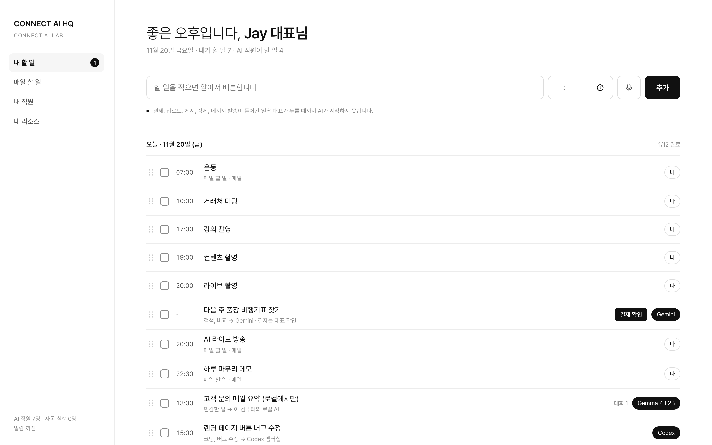
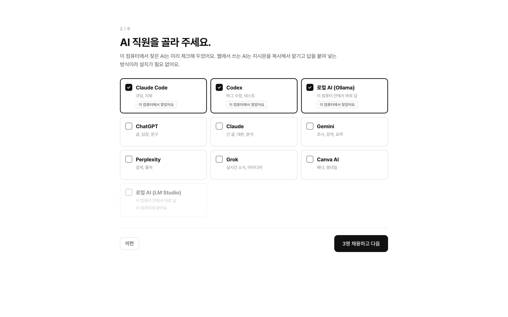
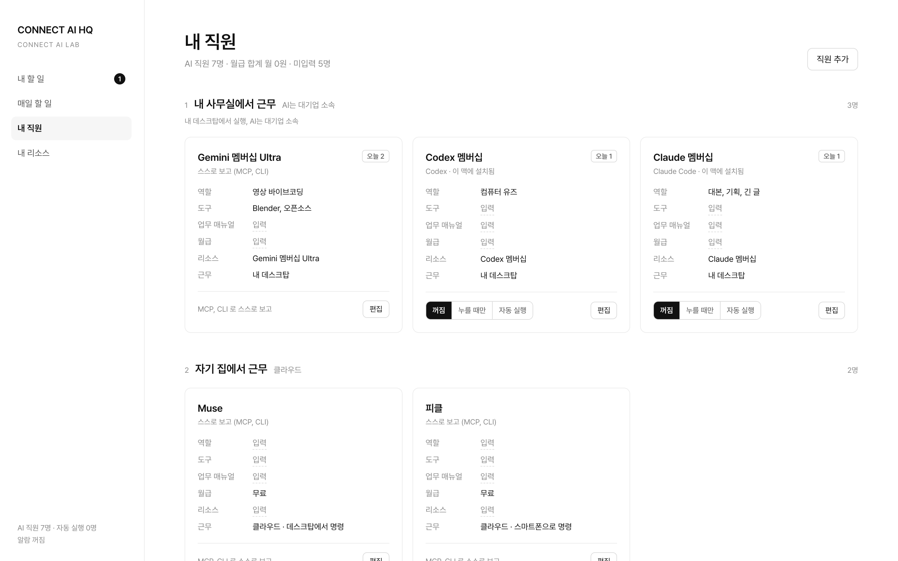

# CONNECT AI HQ v2

**인공지능 시대, 당신의 삶과 AI 일을 함께 최적화하는 나만의 본사**

CONNECT AI HQ v2는 단순히 할 일을 적는 앱이 아닙니다. **나의 컨디션(삶)** · **나의 AI 직원(팀)** · **나의 AI 사무실(컴퓨터·브라우저·스마트폰)** 을 화이트·블랙 미니멀 OS 한 곳에 연결해, 인공지능 시대의 삶과 일을 함께 최적화합니다. 사람은 결정과 건강을 챙기고, AI 직원은 알아서 일하고 인수인계합니다.

무료 · 소스 공개 · npm 의존성 0 · 데이터는 내 컴퓨터 안에만 · [English](README.en.md) · [v2 변경 이력](CHANGELOG.md)



## v2에서 달라진 3가지 축 — 삶 · AI 직원 · AI 사무실

| 축 | 하는 일 |
| --- | --- |
| **1. 나의 삶 · 컨디션 최적화** | 아이폰 Apple Health(단축어) · 안드로이드 Health Connect · 5초 기록으로 **걸음 수 · 수면 · 심박수 · 운동**을 로컬에만 기록하고, 피곤한 날엔 AI 직원에게 무리 없이 일을 위임하도록 제안합니다. (건강 데이터는 청사진·리포트·AI 프롬프트에서 완전 격리) |
| **2. 나의 AI 직원 최적화** | **9종 바이브코딩 툴 원클릭 연결**(`connect --yes`), **한국 전통 K-수호 크루 8종**(해태·도깨비·까치·민화 호랑이·청룡·달토끼·꼬마 장승·아기 봉황) + **내 이름·내 이미지 직접 올리기 스튜디오**, 5시간 토큰 사용량 게이지, 토큰 한도(429) 도달 시 대체 AI 자동 인계, `자동 실행` 직원 추가 즉시 착수 |
| **3. 나의 AI 사무실 최적화** | **화이트·블랙 라이브 대시보드**(AI 회사 구조도 · 업무 분포 · 24시간 타임라인 · 실시간 RAM 추이), **RAM 85% 상한 보호 · 대체 컴퓨터 우회 · 대기열 보호**, 3분 먹통 감시(`hang-watchdog`), 작업 중 맥 잠자기 방지(`caffeinate`), Computer Use · 7종 브라우저 · 아이폰 미러링/안드로이드 연결 |

## 시작하기 (1분 완성)

```bash
npx github:wonseokjung/connect-ai-autonomous-company
```

Node 20 이상이면 됩니다. 설치할 npm 패키지도, 넣을 API 키도 없습니다. 본사가 켜지고 브라우저에서 `http://127.0.0.1:8790` 이 열립니다. 끄려면 터미널에서 `Ctrl+C`.

### 내 바이브코딩 툴 9종 한 번에 연결하기

```bash
# 미리보기 (아무 파일도 바꾸지 않음)
npx github:wonseokjung/connect-ai-autonomous-company connect --dry-run

# 감지된 모든 바이브코딩 툴에 MCP + 직원 수첩(스킬) 한 번에 안전 연결 (.bak 자동 백업)
npx github:wonseokjung/connect-ai-autonomous-company connect --yes

# 깔끔하게 연결 해제 (기존 다른 MCP 설정은 100% 보존)
npx github:wonseokjung/connect-ai-autonomous-company disconnect --yes
```

자동 감지·연결 지원 9종: **Claude Code · Codex · Antigravity (`agy`) · Gemini CLI · OpenCode · Cursor · Windsurf · Claude Desktop · LM Studio** + 공용 에이전트 스킬(`~/.agents/skills/aihq-employee`).

### 처음 열면 1분 시작하기가 뜹니다

1. **대표 이름, 회사 이름**
2. **AI 직원**: 이 컴퓨터에서 찾은 바이브코딩 툴(`Claude Code`, `Codex`, `Antigravity`, `OpenCode`, `Gemini CLI`, `Cursor`, `Ollama`, `LM Studio`)은 미리 체크되어 있고, 웹·클라우드 AI(`ChatGPT`, `Claude`, `Gemini`, `Dots`, `Muse`, `Manus`, `피클`, `Canva AI`)는 눌러서 고릅니다.
3. **AI 사무실 · 브라우저 · 오픈소스**: 이 컴퓨터는 본사로 자동 등록되며, 브라우저(`Ego Lite`, `Aside`, `Chrome`, `Dia`, `Comet`, `Arc`, `Safari`), 오픈소스 도구, `~/.ssh/config` 원격 맥을 한 번에 확인합니다.
4. **자는 시간**: 이 시간에는 AI가 대표를 부르지 않고 알림도 울리지 않습니다.
5. **바이브코딩 툴 연결**: 위 `connect --yes` 한 줄 복사 및 실시간 연결 상태 확인.
6. **안전 규칙 한 줄**: 돈과 공개는 대표 손으로만 (+ 첫 자동 루틴 선택).



데이터는 `~/.connect-ai-hq/data/hq.json` 한 파일입니다. 저장할 때마다 임시 파일에 쓰고 원자적으로 교체하며, 하루 한 번 `backups/` 에 복사본을 남깁니다 (14개 보관). 예시 회사로 둘러보려면:

```bash
AIHQ_SEED=example AIHQ_DATA_DIR=./example-data npx github:wonseokjung/connect-ai-autonomous-company
```

저장소에서 바로 켤 때는 `node bin/connect-ai-hq.mjs` 입니다.

## 화면 구성 — 5개 본사 화면 + 스마트폰 포켓 라이브 뷰

| 화면 | 하는 일 |
| --- | --- |
| **오늘 할 일** (`#home`) | 할 일을 적으면 (말로 해도 됨) 담당 AI·최적 컴퓨터·브라우저·계정·안전선을 자동 연결합니다. `자동 실행` AI 직원에게는 추가 즉시 착수(위험 게이트 제외)하며, 완료·결재 요청 시 맥 데스크탑 알림이 뜹니다. |
| **대시보드** (`#dashboard`) | 화이트·블랙 미니멀 SVG 그래프 — **AI 회사 라이브 구조도**, **대표 컨디션 · 헬스 3종 게이지 & 7일 추이**, **AI 사무실 RAM 85% 추이 & 런타임 안정화**, **AI 직원 업무 분포 · 5시간 토큰 한도 · 24시간 타임라인**. |
| **자동 루틴** (`#daily`) | 매일 지정 시각 또는 5분~1시간 간격 반복 실행, 끝난 뒤 다음 AI에게 넘기는 릴레이, `THE FOUNDER` 루틴 팩(1클릭), **수강생·팀 공유용 청사진(Blueprint) 내보내기/가져오기**(개인정보·헬스·사진 자동 제거). |
| **AI 직원** (`#staff`) | 3종 AI 직원(내 사무실 대기업 AI · 클라우드 AI · 내 컴퓨터 상주 로컬 AI)의 역할·구독료·대체 순위(`fallbackTo`)·5시간 토큰 사용량·캐릭터를 관리합니다. |
| **AI 사무실** (`#resources`) | 컴퓨터(RAM 85% 상한 · 대체 컴퓨터 · Computer Use), **스마트폰(아이폰 미러링 Computer Use · 안드로이드 adb/scrcpy · 모바일 AI)**, 7종 브라우저(+직접 추가), 오픈소스 도구, 디자인 스타일, **연결 계정별 자동화 권한**(`금지 / 승인 후 / 자동`). |
| **포켓 라이브 뷰** (`#pocket`) | 스마트폰·서브 모니터에 켜두는 컴팩트 라이브 화면 — 대표 컨디션·본사 RAM·AI 직원 컬러 캐릭터 카드·5시간 토큰 바·1탭 승인·빠른 1줄 지시. |



## CONNECT AI LAB 캐릭터 스튜디오

- **한국 전통 「K-수호 크루 8종」 (기본)**: 해태 · 도깨비 · 까치 · 민화 호랑이 · 청룡 · 달토끼 · 꼬마 장승 · 아기 봉황
- **모던 랩 크루 8종 (선택)**: 노바 · 볼트 · 루미 · 모모 · 코코 · 보보 · 핍 · 징
- **표현 스타일 4종 (1클릭 전체 통일 또는 직원별 선택)**: `스튜디오 3D` · `코딩 모션` (눈 깜빡임·호흡·타자 SVG) · `픽셀 펫` (16×16 컬러 도트) · `컬러 미니멀`
- **직접 만들기**: 직원마다 **캐릭터 이름(호칭)** 자유 지정(호칭으로 할 일 자동 배분까지 연동) + **파일 선택 · 드래그&드롭 · 클립보드 `⌘V` 붙여넣기** 이미지/GIF 업로드 + **내 캐릭터 보관함(최대 16개)** + **AI 이미지 생성 프롬프트 1클릭 복사**

## AI 직원이 일하고 보고하는 방식

- **직접 실행 (본사가 깨움 · Push)**: `Claude Code (claude -p)`, `Codex (codex exec)`, `Antigravity (agy -p)`, `Gemini CLI (gemini -p)`, `OpenCode (opencode run)`, 로컬 AI (`Ollama`, `LM Studio`). 권한 건너뛰기 플래그는 절대 쓰지 않습니다.
- **IDE · 에이전트 출근 (MCP · Pull)**: `Cursor`, `Windsurf`, `Claude Desktop` 등에서는 "출근해 / 내 할 일 확인해"라고 부르면 MCP 출입증(`whoami`, `list_my_tasks`, `claim_task`, `post_message`, `handoff`, `complete_task`, `request_approval`)으로 본사와 실시간 협업합니다.
- **웹 · 클라우드 · 폰 AI**: 지시서(프롬프트 + 계정 권한 + 브라우저/미러링 안전선)를 자동 조립해 복사해서 맡깁니다.
- **런타임 안정화**: 3분 무응답 먹통 감시(`hang-watchdog`) 자동 종료·인계, 작업 중 맥 잠자기 방지(`caffeinate`), 토큰 한도(429) 자동 쿨다운·대체 AI 전환, RAM 85% 초과 시 대체 컴퓨터 우회·대기열 보호.

```bash
npx github:wonseokjung/connect-ai-autonomous-company task list --mine codex
npx github:wonseokjung/connect-ai-autonomous-company task claim t5 --from codex
npx github:wonseokjung/connect-ai-autonomous-company handoff t5 --from codex --done "3곳 비교" --stuck "결제 화면" --why "카드 결제 필요" --to jay
npx github:wonseokjung/connect-ai-autonomous-company ask-approval "항공권 결제" --from codex --kind 결제 --task t5
```

## 한 가지 안전 규칙 · 계정별 자동화 권한

- **결제 · 업로드 · 게시 · 삭제 · 메시지 발송**이 들어간 일은 `자동 실행` AI 직원이라도 대표가 화면에서 승인할 때까지 멈춥니다. (AI CLI·MCP에는 승인 도구가 아예 없어 서버가 거절합니다.)
- YouTube · Instagram · 네이버 블로그 · 네이버 클립 · TikTok · Threads · X · LinkedIn · 카카오톡 채널 · 스마트스토어 · GitHub · 토스페이먼츠 · PayPal 계정은 행동마다 `금지 / 승인 후 / 자동`을 따로 설정할 수 있습니다. **비밀번호 입력 · 본인인증 · 결제**는 어떤 설정을 해도 대표만 할 수 있습니다.

## 대표 컨디션 · 헬스 연동 (로컬 전용)

- 대시보드 → `폰 연동`에서 로컬 전용 수신 주소(`POST /api/health/ingest`)와 보안 토큰(`X-AIHQ-Health-Token`)을 확인해 아이폰 단축어(Apple Health) 또는 안드로이드 Health Connect(MacroDroid/Tasker)와 1분 만에 연결할 수 있습니다.
- 모든 건강 데이터는 이 컴퓨터의 `hq.json`에만 저장되며 외부 서버 전송, 청사진 내보내기, 데일리 리포트, AI 프롬프트에 절대 포함되지 않습니다.

## 환경변수 (모두 선택)

| 이름 | 쓰임 |
| --- | --- |
| `AIHQ_PORT` | 기본 `8790` (`--port` 와 같음) |
| `AIHQ_DATA_DIR`, `AIHQ_WORKSPACES` | 데이터 폴더와 AI 직원 작업 폴더 (기본 `~/.connect-ai-hq/`) |
| `AIHQ_SEED` | `example` 이면 데이터 파일이 없을 때 예시 회사로 시작 |
| `AIHQ_URL` | CLI 와 MCP 가 부를 본사 주소 |
| `AIHQ_LLM_MODEL` | 배분에 쓸 Ollama 모델 (없으면 자동 선택, 모델이 없으면 규칙으로) |
| `AIHQ_OLLAMA_URL`, `AIHQ_LMSTUDIO_URL` | 로컬 모델 주소 |
| `AIHQ_CLAUDE_BIN`, `AIHQ_CODEX_BIN`, `AIHQ_GEMINI_BIN`, `AIHQ_AGY_BIN`, `AIHQ_OPENCODE_BIN` | 실행 파일 경로 (없으면 PATH 에서 자동 탐색) |
| `AIHQ_HANG_MS` | 먹통 감시 무응답 시간 (기본 `180000`ms = 3분) |
| `AIHQ_NO_CAFFEINATE`, `AIHQ_NO_NOTIFY` | `1` 이면 잠자기 방지 / 맥 데스크탑 알림 비활성화 |
| `AIHQ_NO_OPEN`, `AIHQ_DISPATCH` | 브라우저 자동 열기 / 원격 배차기 비활성화 (`0`·`1`, 시험용) |

## 보안 · 시험

- 기본 `127.0.0.1` 에만 바인딩됩니다. 폰에서 보기를 켰을 때만 같은 와이파이 주소가 열리며, 6자리 일회용 페어링 코드 없이는 접속할 수 없습니다.
- 사람 요청은 Same-Origin · `X-HQ-UI` 헤더 · HttpOnly 세션 쿠키를 모두 검사합니다. AI가 쓴 텍스트는 인용 데이터로만 취급해 프롬프트 인젝션을 차단합니다.

```bash
npm test
```

신규 사용자 E2E 시뮬레이션(9종 툴 `connect`/`disconnect` · 빈 회사 온보딩 · `agy`/`opencode` 추가 즉시 자동 착수 · 게이트 정지), 안전 정지 47종, 배분, RAM 85%/토큰 쿨다운 최적화, 먹통 감시·절전 방지, 5시간 토큰 스캔, 헬스 프라이버시 차단, 캐릭터 이미지 XSS 차단, 청사진 공유 등 **56개 자동화 테스트**를 통과합니다.

## 라이선스

무료 · 소스 공개 (fair-code). 개인과 5인 미만 조직은 내부에서 무료로 쓰고 고칠 수 있습니다. 5인 이상 조직, 판매, 호스팅 서비스, 이 소프트웨어로 만드는 유료 강의는 CONNECT AI LAB 의 허락이 필요합니다. 이름과 로고는 CONNECT AI LAB 의 것입니다. 자세한 조건은 [LICENSE.ko.md](LICENSE.ko.md) (영문 [LICENSE.md](LICENSE.md) 가 우선)를 봐 주세요.

CONNECT AI LAB · 인공지능 시대, 삶과 AI 일의 최적화
